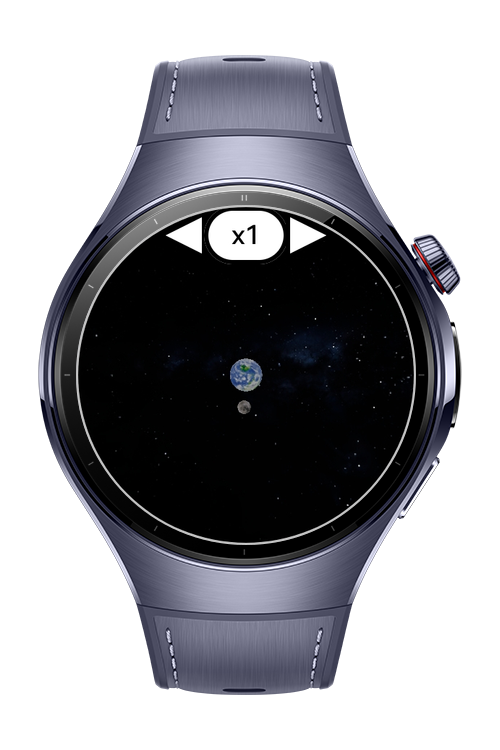
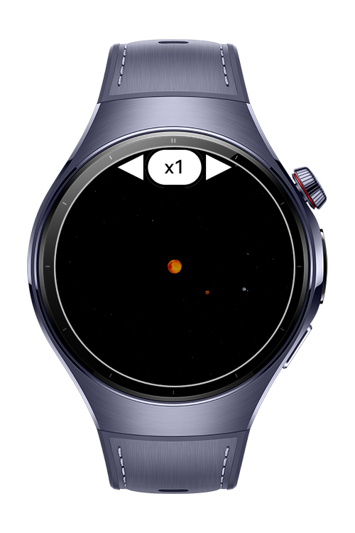

> **Note:** To access all shared projects, get information about environment setup, and view other guides, please visit [Explore-In-HMOS Index](https://github.com/Explore-In-HMOS/hmos-index).

# N Body Simulation

This sample shows an example of n-body simulation that includes 3D mathematics and rendering utility library that uses Vec2 and Vec3 for 2D and 3D vector arithmetic (position calculation, direction, distance). Position3 is used for planet positions and Quaternion is used for rotation of planets.

# Preview

<div>
    
    
</div>

# Use Cases

- Vec2 and Vec3 for 2D and 3D vector arithmetic
- Position, direction, distance calculations with Position3, Quaternion
- Example usages for fundamental ArkGraphics3D components such as Scene, SceneResourceFactory, Environment, Texture and Camera

# Tech Stack

- **Languages:** ArkTS
- **Framework:** HarmonyOS SDK 6.0.0(20)
- **Tools:** DevEco Studio 6.0.0 Release
- **Libraries:** @kit.ArkGraphics3D

# Directory Structure

```
.\entry\src\main
│   module.json5
│
├───ets
│   ├───common
│   │       Body.ets
│   │       OrbitCameraHelper.ets
│   │       VectorMath.ets
│   │
│   └───pages
│           Index.ets
│           SimulationPage.ets
│
└───resources
    ├───base
    │   └───profile
    │           router_map.json
    │
    └───rawfile
        ├───Environment
        │       2k_stars_milky_way.jpg
        │
        ├───Planets
        │       earth.jpg
        │       mercury.jpg
        │       moon.jpg
        │       sun.jpg
        │       venus.jpg
        │
        └───shaders
            └───custom_shader
```

# Constraints and Restrictions

DevEco Studio Simulator is not supported.

## Supported Devices

- Huawei Watch 5

# License

**N Body Simulation** is distributed under the terms of the MIT License.
See the [LICENSE](/LICENSE) for more information.